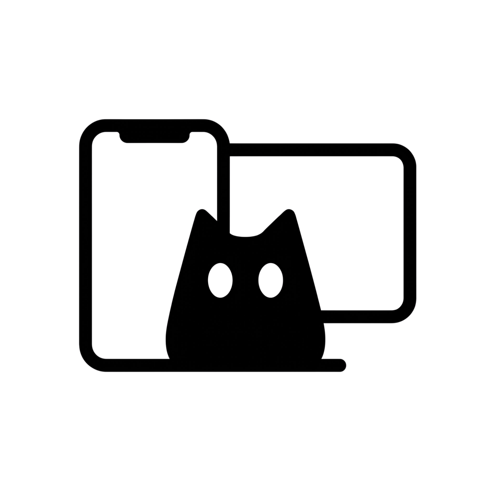

<div align="center">

<picture>
  <source media="(prefers-color-scheme: dark)" srcset="Source/Resources/LogoDark.png">
  <source media="(prefers-color-scheme: light)" srcset="Source/Resources/LogoLight.png">
  
</picture>

# USB Mirror for Mac

**Your iPhone screen and audio on your Mac. Ready for OBS.**

[](https://github.com/rzfsaz/usb-mirror-mac/releases/latest)


[**Download for Mac**](https://github.com/rzfsaz/usb-mirror-mac/releases/latest) · [Report a bug](https://github.com/rzfsaz/usb-mirror-mac/issues) · [Panduan Indonesia](PANDUAN.md)

</div>

A lightweight native macOS app for mirroring an iPhone over USB, playing its audio on the Mac, and capturing a clean window in OBS. Includes automatic portrait/landscape sizing, four interface languages, and light/dark themes. No account or driver installation is required by USB Mirror.

The interface supports Bahasa Indonesia, English, Japanese, and Simplified Chinese. Choose a language in the app; your choice is saved. The extended user guide is in Indonesian.

## Features

- USB iPhone screen discovery with automatic refresh.
- Separate controls and mirror windows for OBS.
- Automatic portrait/landscape window sizing from iPhone frame dimensions.
- Manual 90° rotation and reset for sources that remain sideways.
- Compact warm-toned controls with an on-demand OBS guide.
- Native AVFoundation video preview with preserved aspect ratio.
- iPhone audio playback with a mute toggle and volume control.
- Audio starts muted; the initial volume is 25%.
- Connection status confirms receipt of the first video frame.
- Stops a session if no video frame arrives within 12 seconds.

## Download

Download the Apple Silicon app ZIP from [GitHub Releases](https://github.com/rzfsaz/usb-mirror-mac/releases/latest), unzip it, and open USB Mirror.app. You can move it to Applications. The downloaded app is locally ad-hoc signed, not Apple-notarized; macOS may require explicit approval in Privacy & Security. Alternatively, build from source below.

## Appearance and language

Choose **System**, **Light**, or **Dark** under Theme. The in-app logo switches between the provided black and white variants. Theme and language changes apply immediately without stopping capture, and persist across launches. On first launch, the language follows the system when supported and otherwise defaults to English.

macOS permission dialogs follow the OS language, independently of the in-app language selector. OS-provided error descriptions may also use the system language. The capture window name stays **USB Mirror — iPhone** in every language so OBS can keep targeting it.

## Requirements

- Apple Silicon Mac running macOS 14 or later.
- Xcode with the macOS SDK and Swift compiler only if building from source.
- iPhone and a USB data cable. Connect directly to the Mac for initial troubleshooting.

## Build and run

```sh
chmod +x build.command
./build.command
open "USB Mirror.app"
```

The build script compiles the Swift source and creates a locally ad-hoc-signed app bundle. It does not install drivers or download dependencies. The generated app is not Developer ID signed or notarized, and is excluded from Git.

## Use

1. Connect the unlocked iPhone to the Mac and accept **Trust This Computer** if prompted.
2. Open USB Mirror and wait for the iPhone to appear.
3. Click **Mulai mirroring**. Allow camera and microphone access when macOS requests it; capture uses the selected iPhone USB device.
4. Wait for the **Gambar iPhone masuk** status.
5. Enable **Suara iPhone** to hear the iPhone audio and adjust its volume.
6. In OBS, add **macOS Screen Capture** and select **USB Mirror — iPhone**. Enable audio capture if available, or use a separate **macOS Audio Capture** source for USB Mirror. Avoid capturing the same audio twice.

See [PANDUAN.md](PANDUAN.md) for the full Indonesian guide and troubleshooting steps.

## Validation and limitations

Portrait/landscape switching was also confirmed on the connected iPhone after the 1.1 update.

Screen mirroring and audio playback were confirmed with an iPhone 16 and an Apple Silicon Mac running macOS 26.2 using a direct USB-C connection. OBS capture and end-to-end latency have not been independently measured.

This is an initial implementation. It does not guarantee zero latency or a specific frame rate, and does not provide remote touch control, a virtual camera, recording, or streaming. Protected content may not display or play audio. Other hardware and OS combinations require testing.

## Source layout

- `Source/main.swift`: application, device discovery, capture session, preview, and controls.
- `Source/Info.plist`: app metadata and capture permission descriptions.
- `build.command`: local Apple Silicon build and signing script.

## References

- [Apple: CoreMediaIO screen-capture devices](https://developer.apple.com/documentation/coremediaio/kcmiohardwarepropertyallowscreencapturedevices)
- [OBS: macOS audio capture](https://obsproject.com/kb/macos-desktop-audio-capture-guide)

## Geometry checks

```sh
xcrun swiftc Source/MirrorGeometry.swift Source/Localization.swift Tests/main.swift -o /tmp/usbmirror-geometry-tests
/tmp/usbmirror-geometry-tests
```

Checks cover portrait/landscape sizing, desktop bounds, aspect preservation, and invalid dimensions. Automatic sizing follows the dimensions sent by the iPhone; it cannot force an iPhone app to support landscape. Full-screen windows keep their desktop size while the video fits inside.

## Feedback

If this helps your streaming setup, a star helps others discover the project. Bug reports are welcome: include your Mac model, macOS version, iPhone model, iOS version, and the steps to reproduce the issue. Avoid posting personal screen content or device identifiers.

Feature ideas and improvements can be proposed through GitHub Issues or pull requests.
